# Junction Studio

English | [简体中文](README.md)

Junction Studio — Git & Code Navigator: a desktop client that recreates Android Studio / IntelliJ's Git features one to one, together with cross-language code indexing and navigation (Kotlin, Java, C/C++, Objective-C, Rust, Swift, Dart, Go, V and more, including JNI, Dart FFI, Rust `extern "C"` and Swift/ObjC bridges).
Built with Rust + [GPUI](https://www.gpui.rs) + [GPUI Kit / gpui-component](https://github.com/longbridge/gpui-kit).
Like IntelliJ's git4idea, all Git operations run the `git` command line.

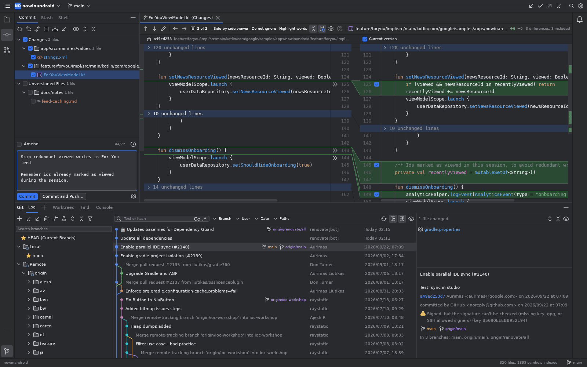

## Download

Every push to master builds all three platforms with GitHub Actions and publishes them under [Releases › latest](https://github.com/wizardmly/junction/releases/tag/latest) (the link never changes):

| Platform | File | How to use |
|---|---|---|
| Windows x64 | `junction-windows-x64.zip` | Unzip and run `Junction Studio/junction.exe` |
| macOS (universal: Apple silicon and Intel) | `junction-macos-universal.dmg` / `junction-macos-universal.app.zip` | Drag Junction Studio into Applications |
| Linux x64 | `Junction-x86_64.AppImage` / `junction-linux-x64.tar.gz` | `chmod +x` and run the AppImage, or unpack the tar.gz |

Checksums are in `SHA256SUMS.txt`.

The macOS build is not notarized, so the first launch says Apple cannot verify that "Junction Studio.app" is free of malware. Click "Open Anyway" in System Settings › Privacy & Security, or run:

```sh
xattr -dr com.apple.quarantine "/Applications/Junction Studio.app"
```

You can also build it on your own Mac as described below; a locally built app does not show this warning.

## Features

The full checklist with status is in [docs/FEATURES.md](docs/FEATURES.md) (Chinese).

- **Git tool window › Log**: branch tree (favorites, `/` folders, speed search), colored commit graph with long edges collapsed into arrows, Branch / User / Date / Paths filters, commit details and changed-file tree, GPG/SSH signature status, and the full commit context menu (Cherry-Pick, Reset, Revert, Reword, Fixup, Squash, Drop, Interactively Rebase from Here, Push All up to Here…).
- **Commit tool window**: non-modal commit, changelists or staging area, partial commits by chunk or by line, Amend, commit message spell check and history, Shelf and Stash.
- **Diff and Merge**: side-by-side and unified diff with an editable right side and per-chunk `>>` revert; three-way merge tool (magic wand for simple conflicts, accept per chunk); Conflicts dialog; image diff.
- **Branches and remotes**: branches popup in the title bar (Recent / Local / Remote / Tags with every branch action), Fetch / Pull / Push / Update Project dialogs, interactive rebase, Merge / Rebase dialogs, tags, patches, worktrees, submodules and multiple repository roots.
- **Per-file**: Annotate with Git Blame, file history, history for selection, change markers in the editor gutter (rollback or stage one chunk).
- **GitHub / GitLab**: token login, Pull Requests tool window (comments, reviews, merge), Share Project, Create Gist, account repositories in Clone.
- **Code index and navigation**: built-in tree-sitter index plus per-language LSP servers; Go to Declaration (Ctrl+B / Ctrl+click), Find Usages, implement / override gutter icons; External Libraries (sources of Gradle, Cargo, Go, Dart/Flutter and C/C++ dependencies and SDKs).
- **Search**: Search Everywhere (double Shift), Find / Replace in Files, Find Action, Recent Files, File Structure, Go to Line.
- **Editor and look**: tabs and split editors, syntax highlighting in Android Studio's colors, IntelliJ new UI icons, light and dark themes, IntelliJ and macOS keymaps.

## Screenshots

The screenshots show the open-source [Now in Android](https://github.com/android/nowinandroid) project opened in Junction Studio, and Junction's own sources for External Libraries.

### Git Log

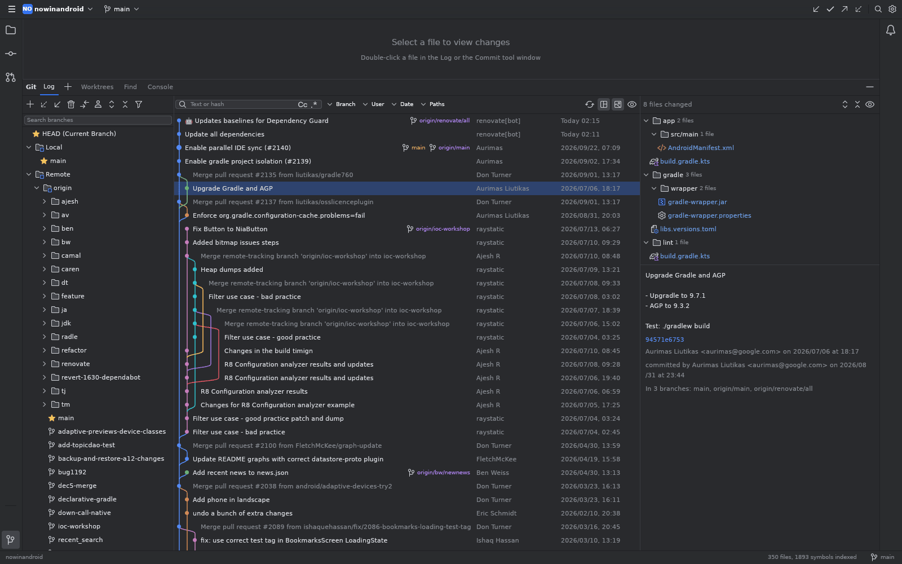

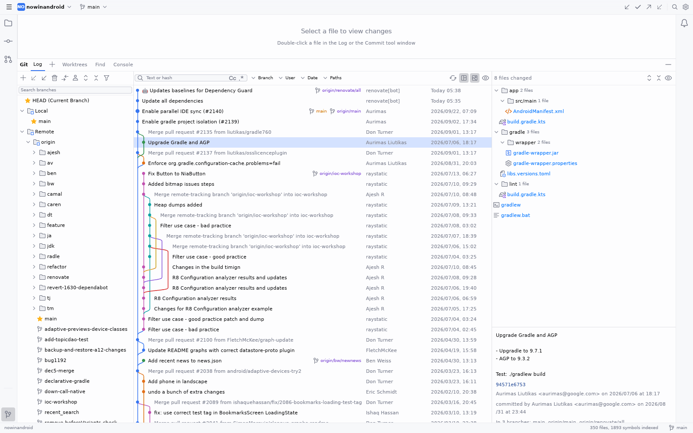

Commit context menu:

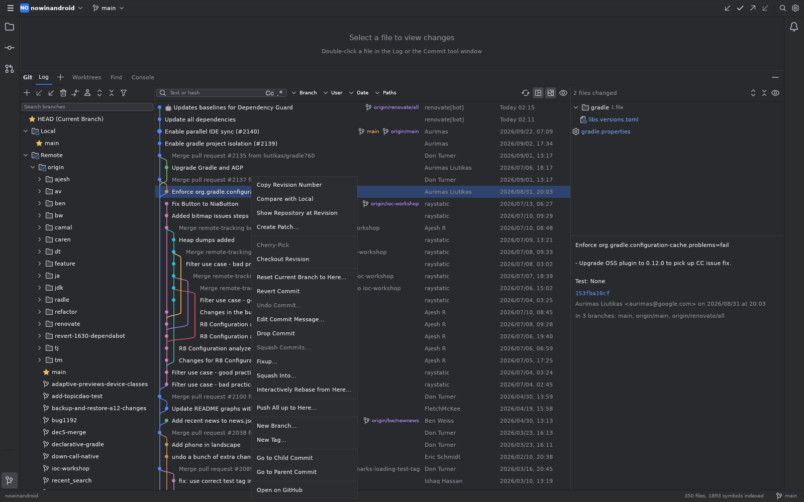

### Commit tool window and diff

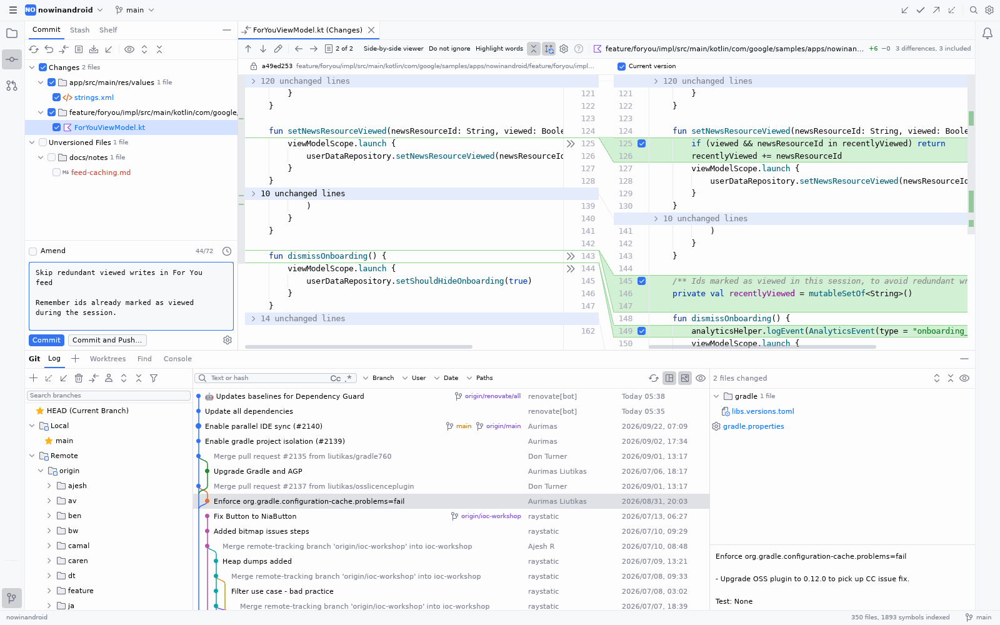

Side-by-side diff (editable right side, checkboxes pick the chunks to commit):

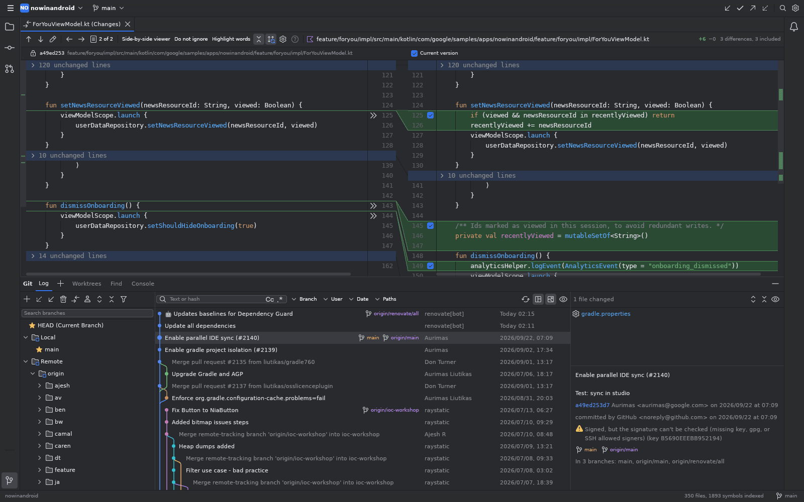

### Branches popup

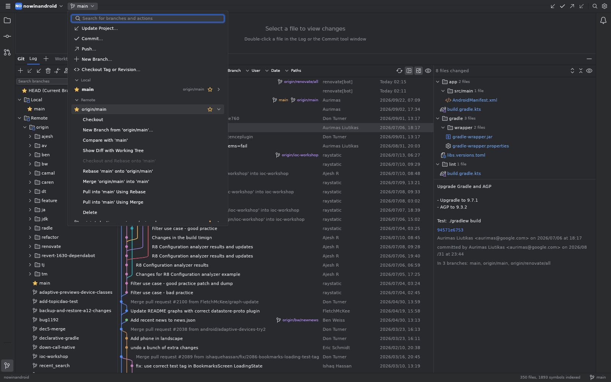

### Interactive rebase

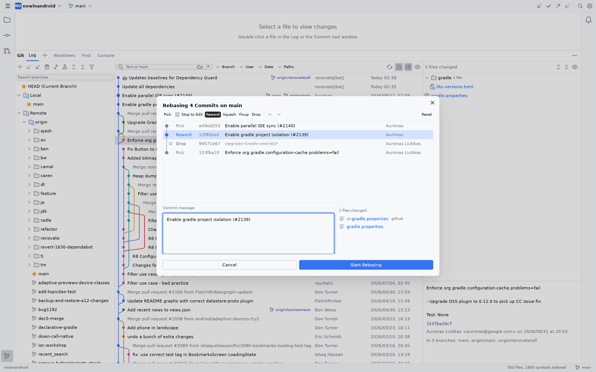

### Conflicts and three-way merge

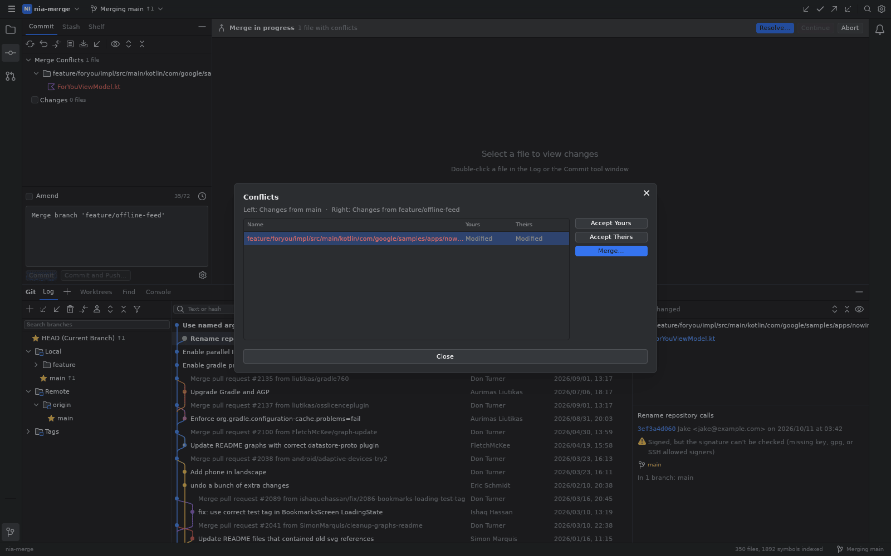

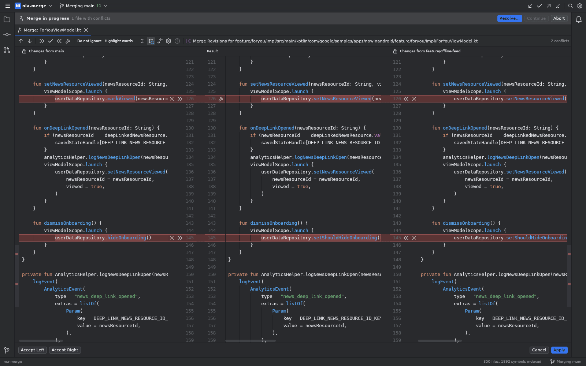

### Annotate with Git Blame

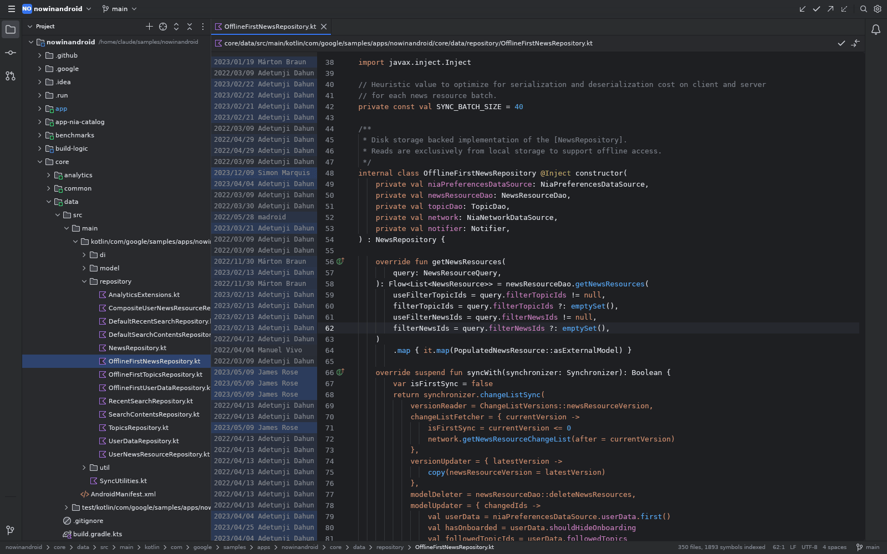

### Editor, navigation and usages

Kotlin editor with Android Studio colors and implement / override gutter icons:

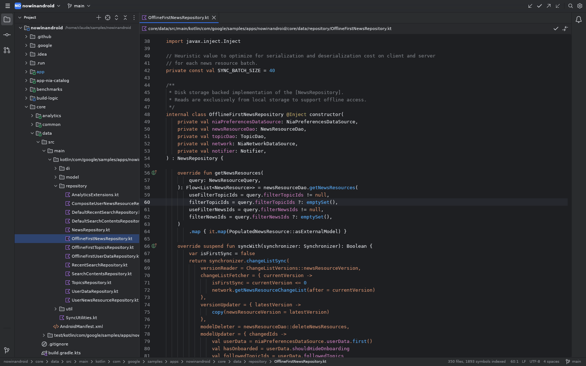

Ctrl+B / Ctrl+click on a declaration lists its usages:

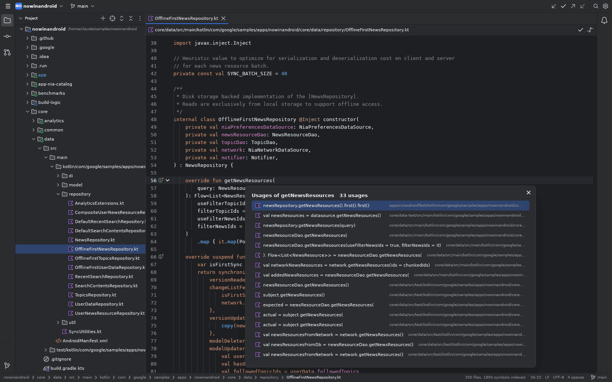

### External Libraries

Dependency and Rust standard library sources are indexed and open read-only when you navigate into them:

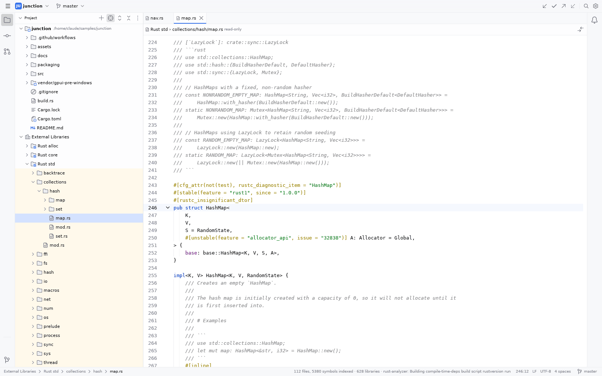

### Search

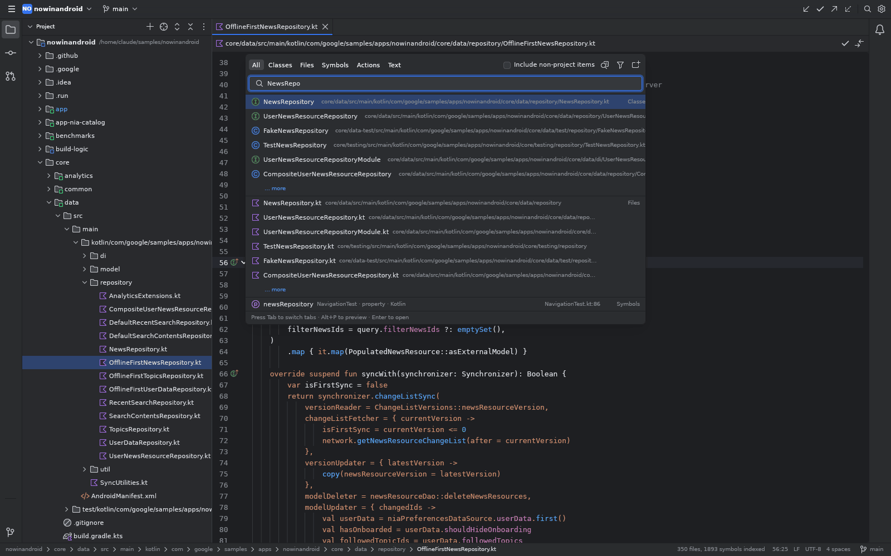

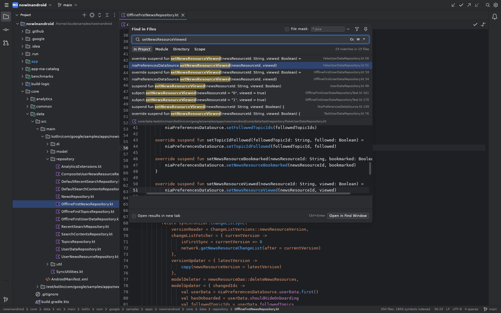

## Building Junction Studio.app on macOS

1. Install **Xcode** from the App Store, open it once and accept the license. The build needs Xcode's Metal shader compiler; the Command Line Tools alone are not enough.
2. Install Rust:

   ```sh
   curl --proto '=https' --tlsv1.2 -sSf https://sh.rustup.rs | sh
   ```

3. Get the code, then build and install it into Applications:

   ```sh
   git clone https://github.com/wizardmly/junction.git
   cd junction
   packaging/build-macos-app.sh --install
   ```

   Without `--install` it only produces `target/Junction Studio.app`. The first build takes 10 to 15 minutes; later ones are much faster.

To update later, run `git pull` in the `junction` folder and then `packaging/build-macos-app.sh --install` again.

## Running from source

Requires Rust 1.90+ and `git`.

```sh
cargo run --release -- /path/to/repo     # opens the current directory when no path is given
JUNCTION_THEME=light cargo run           # light theme
```

- **Windows**: needs Visual Studio Build Tools (MSVC). On Windows 11 the window uses the Mica backdrop.
- **macOS**: needs Xcode (see above).
- **Linux**: install the dependencies first: `sudo apt install libxkbcommon-x11-dev libwayland-dev libx11-xcb-dev libvulkan1 libfontconfig-dev libssl-dev`.

Navigation and External Libraries use the language servers and SDKs installed on your machine (rust-analyzer, clangd, kotlin-lsp, gopls, the Dart SDK and so on) and fall back to the built-in index when they are missing.

## Layout

```
src/git/        git backend: command runner and Console log, log parsing, graph layout, refs, status/commit, merge, rebase
src/hosting/    GitHub / GitLab APIs
src/index/      code index: tree-sitter symbols, cross-language bridges, LSP, External Libraries, navigation and usages
src/model.rs    repository state (background loading, selected commit, operations + notifications)
src/ui/         UI: workspace (main window), log_view, commit_view, diff_view, merge_view, dialogs, search, editor
src/theme.rs    IntelliJ Int UI light / dark palettes
vendor/         patched gpui-component and other dependencies (changes marked "Junction:")
```

`cargo test` runs the unit tests for the parsers, graph layout, index, file trees and more.
